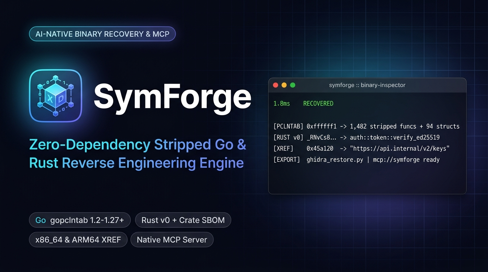
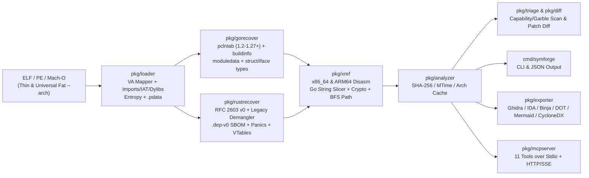

<div align="center">
  

  <h1>SymForge</h1>
  <p><strong>Zero-Dependency Stripped Go &amp; Rust Binary Forensics, Symbol/Type/SBOM Recovery, Multi-Arch XREF Analyzer &amp; Native MCP Server</strong></p>

  <p>
    <a href="https://github.com/aloneangel45/SymForge/actions/workflows/ci.yml"></a>
    <a href="https://github.com/aloneangel45/SymForge/releases/latest"></a>
    <a href="https://go.dev/"></a>
    <a href="https://modelcontextprotocol.io"></a>
    <a href="LICENSE"></a>
  </p>
</div>

---

## Why SymForge?

Modern cloud daemons, CLI tools, and embedded agents are overwhelmingly written in **Go** and **Rust** and shipped stripped (`-ldflags="-s -w"` or `-C strip=symbols`):

- Standard disassemblers (`objdump`, `nm`) see **zero symbols**, massive contiguous **non-null-terminated string blobs** (`go:string.*` / Rust `&str`), and thousands of unlabeled runtime functions (`FUN_0045a120`).
- Existing tools are fragmented: `GoReSym` handles Go `pclntab` JSON dumps (without Rust support, call graphs, disassembly, or MCP), `cargo-auditable` only reads `.dep-v0` SBOMs, and Ghidra/IDA MCP plugins require a multi-gigabyte JVM/GUI instance running in the background.

**SymForge** unifies stripped **Go + Rust** recovery, pure-Go **`x86_64` & `ARM64` disassembly + XREFs**, **Ghidra / IDA / Binary Ninja** script generation, **CycloneDX 1.5 SBOM** extraction, and a **native Model Context Protocol (MCP) server** into a single static binary (`CGO_ENABLED=0`) that analyzes 9 MB stripped binaries in **under 500 ms**.

| Capability | `nm` / `objdump` | `GoReSym` | Ghidra + JVM MCP | **SymForge** |
| :--- | :---: | :---: | :---: | :---: |
| **Stripped Go `pclntab` (Go 1.2 – 1.27+)** | No | Yes | Partial | **Yes (`0xfffffffb`..`0xfffffff1`)** |
| **Go `struct` & `interface` Type Reconstruction** | No | Yes | Partial | **Yes (incl. Go 1.27 `abi.Type` tables)** |
| **Go Non-Null-Terminated `(ptr, len)` String Slicing** | No | No | Plugin | **Yes (Static + Register-Pair ABI)** |
| **Rust RFC 2603 `v0` (`_R`) + Legacy Demangler** | Partial | No | Partial | **Yes (Pure Go, Cycle-Safe)** |
| **Stripped Rust `.dep-v0`, `PanicLocation` & Trait VTables** | No | No | No | **Yes** |
| **Native Imports (ELF/PE IAT/Mach-O) & Universal Fat `--arch`** | Partial | No | Yes | **Yes (Pure Go)** |
| **Pure-Go `x86_64` & `ARM64` Call Graph + BFS Call-Path + Disasm** | Disasm only | No | Slow (JVM) | **Yes (`< 100 ms` typical)** |
| **Binary Patch Diffing & Behavioral / Go `garble` Triage** | No | No | Plugin | **Yes (`symforge diff` / `scan`)** |
| **Crypto Constant XREFs (AES / SHA-256 / ChaCha20)** | No | No | Plugin | **Yes** |
| **Ghidra / IDA / Binja / DOT / Mermaid / CycloneDX 1.5** | No | IDAPython | Native | **All 6 Formats** |
| **Headless Native MCP Server (`stdio` + HTTP/SSE)** | No | No | Requires GUI | **Built-in (11 Tools)** |

---

## Installation

### Linux & macOS (SHA-256 Verified)
```sh
curl -fsSL https://raw.githubusercontent.com/aloneangel45/SymForge/main/install.sh | sh
```

### Windows PowerShell (Pure .NET, SHA-256 Verified)
```powershell
irm https://raw.githubusercontent.com/aloneangel45/SymForge/main/install.ps1 | iex
```

### From Source (`Go 1.27+`) or Container
```bash
# Pure-Go static install
CGO_ENABLED=0 go install github.com/aloneangel45/symforge/cmd/symforge@latest

# Multi-stage distroless container
docker build -t symforge .
docker run --rm -v "$PWD:/work:ro" symforge inspect /work/target-binary
```

---

## Live Terminal Output

### 1. Stripped Go Binary (`-ldflags="-s -w"`, 9.0 MB PE `x86_64`)
Running `symforge inspect` against a fully stripped Go 1.27 binary recovers **8,097 functions**, **195 packages**, **1,021 struct/interface types**, **13 cryptographic tables**, and **10,000 sliced strings** in **463.4 ms**:

```text
$ symforge inspect ./symforge.exe
=== SymForge Binary Forensics Summary (463.4 ms) ===
  Path        : ./symforge.exe
  SHA-256     : 71d6f526197b9807f88c33f9b57f20421a532ec15c4bf5525947af4a1e9737ea
  Format/Arch : pe / x86_64 (64-bit, little-endian, size=9045504 bytes)
  Language    : go
  Entry/Base  : 0x140089bc0 / 0x140000000 (PIE=true)
  Hygiene     : Stripped=true | PackedLikely=false | MaxEntropy=6.21
  Recovered   : 8097 functions (257 user), 195 packages, 1021 types, 4 deps, 13 crypto, 10000 strings

[Go Metadata]
  Go Version  : go1.27.3
  PCLnTab     : go1.20+ (magic=0xfffffff1 @ 0x14043c280, ptr=8, quantum=1)
  Main Module : github.com/aloneangel45/symforge ((devel))
  ModuleData  : 0x1407d24e0 (types 0x14070f400..0x1407d0158)

[Top Packages / Crates]
  CATEGORY    FUNCTIONS  BYTES  PACKAGE
  user        77         78144  github.com/aloneangel45/symforge/pkg/rustrecover
  user        49         55936  github.com/aloneangel45/symforge/pkg/gorecover
  user        38         55808  github.com/aloneangel45/symforge/pkg/xref
  user        24         27264  main
  user        22         45088  github.com/aloneangel45/symforge/pkg/mcpserver

[Cryptographic Constants]
  0x140428460  [ChaCha20] ChaCha20 / Salsa20 Constant (referenced by 3 fn)
  0x1407eb860  [SHA-256] SHA-256 Initial Hash Values (referenced by 1 fn)
  0x1407ecd00  [AES] AES Te0 T-Table (referenced by 2 fn)
  0x1407ef640  [AES] AES Forward S-Box (referenced by 1 fn)
```

### 2. Deep Function Call-Graph, String Slicing & Annotated Disassembly
```text
$ symforge fn ./symforge.exe AnalyzeLoaded --max-insns 18
Function    : github.com/aloneangel45/symforge/pkg/analyzer.AnalyzeLoaded
Address     : 0x1401f5240 .. 0x1401f60c0 (3712 bytes)
Package     : github.com/aloneangel45/symforge/pkg/analyzer (user, via gopclntab)
Source      : github.com/aloneangel45/symforge/pkg/analyzer/analyzer.go:171

Calls (20):
  -> 0x1400c4380  time.Now
  -> 0x1401a9c60  github.com/aloneangel45/symforge/pkg/gorecover.Analyze
  -> 0x1401c4000  github.com/aloneangel45/symforge/pkg/rustrecover.Analyze
  -> 0x1401f3a40  github.com/aloneangel45/symforge/pkg/xref.Analyze

Called By (1):
  <- 0x1401f47c0  github.com/aloneangel45/symforge/pkg/analyzer.(*Engine).analyzeCached

String XREFs (6):
  [0x1401f52e8 -> 0x1403f816a] (general) "go recovery failed: %w"
  [0x1401f5393 -> 0x1403f9a27] (general) "rust recovery failed: %w"
  [0x1401f5c9c -> 0x1403f9a3f] (general) "xref analysis failed: %w"

Disassembly (18 instructions):
  0x1401f5240:  4c8da424a0feffff      lea r12, ptr [rsp-0x160]
  0x1401f5248:  4d3b6610              cmp r12, qword ptr [r14+0x10]
  ...
  0x1401f528a:  e8f1f0ecff            call 0x1400c4380 ; -> time.Now
```

### 3. Stripped Rust Binary (`rustc -O -C strip=symbols -C symbol-mangling-version=v0`)
Even with the symbol table completely stripped, SymForge carves the exact `rustc` commit hash, `.pdata` function boundaries, **396 `core::panic::Location` source records**, and **33 trait vtables** in **53.1 ms**:

```text
$ symforge inspect ./vault_stripped.exe
=== SymForge Binary Forensics Summary (53.1 ms) ===
  Path        : ./vault_stripped.exe
  SHA-256     : 9fe2c76c86a503daa5dcbd010878a7781524025edc540e1c4d18c79c1925d2a1
  Format/Arch : pe / x86_64 (64-bit, little-endian, size=872448 bytes)
  Language    : rust
  Entry/Base  : 0x1400013f0 / 0x140000000 (PIE=true)
  Hygiene     : Stripped=true | PackedLikely=false | MaxEntropy=6.40
  Recovered   : 1725 functions (0 user), 1 packages, 33 types, 0 deps, 0 crypto, 1461 strings

[Rust Metadata]
  Toolchain   : rustc  (58cf8f9c35b355199727627d07ae34a4e2846d67)
  Artifacts   : mangling=stripped | cargo-auditable=false | panics=396 | vtables=33
```

---

## Architecture



---

## Model Context Protocol (MCP) Integration

Connect **SymForge** directly to **Claude Code**, **Cursor**, **VS Code**, **Windsurf**, or **Zed** with a single command—existing MCP servers and JSONC comments are preserved automatically:

```bash
symforge preset claude-code
symforge preset cursor
symforge preset vscode
symforge preset windsurf
symforge preset zed
```

Or configure manually in `.mcp.json` / `mcp_config.json`:

```json
{
  "mcpServers": {
    "symforge": {
      "command": "symforge",
      "args": ["mcp"]
    }
  }
}
```

Need Streamable HTTP / SSE for remote sandboxes or MCP Inspector?
```bash
symforge mcp --http 127.0.0.1:8085
```
*(Protected by automatic loopback `Host` & `Origin` DNS-rebinding guards.)*

### Exposed MCP Tools (11 Tools)

| Tool | Purpose |
| :--- | :--- |
| `analyze_binary` | Token-efficient executive forensic summary (format, Fat Mach-O slices, native imports, entropy, Go/Rust toolchain, top user packages, crypto, high-signal strings). |
| `list_packages_crates` | Browse recovered Go packages & Rust crates filtered by `user`, `dependency`, `stdlib`, or `runtime`. |
| `search_functions` | Search stripped/recovered functions by name, demangled path, package, or source file. |
| `inspect_function` | Inspect one function (`name` or `0x...` VA): callers, callees, string/crypto XREFs, and annotated `x86_64`/`ARM64` assembly. |
| `find_xrefs` | Query URLs, API routes, secret-hygiene candidates, SQL, commands, and AES/SHA-256/ChaCha20 constants with resolved caller names. |
| `recover_types` | Reconstruct Go `struct` field offsets/tags, Go `interface` method sets, and Rust trait `vtable` layouts. |
| `demangle_symbols` | Batch-demangle Rust RFC 2603 `v0` (`_R...`) and legacy (`_ZN...E`) symbols in pure Go. |
| `export_re_script` | Generate Ghidra, IDA Pro, or Binary Ninja recovery scripts, **Graphviz DOT / Mermaid** call graphs, Markdown forensic reports, or CycloneDX 1.5 SBOMs. |
| `diff_binaries` | Patch/version diff two binaries: added/removed/modified functions, packages, Go/Rust deps, native imports, high-signal strings, crypto constants, and risk highlights. |
| `scan_capabilities` | Pure-Go behavioral capability, network IoC (URL/IPv4/IPv6), secret, UPX/entropy, and **Go `garble` obfuscation** triage. |
| `trace_call_path` | BFS shortest directed call-graph path between any two functions (by name, substring, or hex VA) with hop-by-hop addresses and categories. |

*(All binary-accepting MCP tools support optional `"arch"` to select a specific Universal/Fat Mach-O slice such as `"arm64"` or `"amd64"`.)*

---

## Ghidra, IDA Pro, Binary Ninja, Visual Call Graphs & SBOM Workflows

Every exported RE script automatically computes the image-base delta (`currentProgram.getImageBase()` / `ida_nalt.get_imagebase()` / `bv.start`) so PIE binaries mapped at custom bases align cleanly:

```bash
# Restore user & dependency function names, source:line plate comments, and crypto/type bookmarks in Ghidra
symforge export ./target.bin --format ghidra --user-only -o restore_ghidra.py

# Generate an IDAPython 7.x/8.x/9.x recovery script
symforge export ./target.bin --format ida -o restore_ida.py

# Generate a Binary Ninja Python console/headless script
symforge export ./target.bin --format binja --user-only -o restore_binja.py

# Export clean Graphviz DOT or Mermaid flowchart LR call graphs
symforge export ./target.bin --format mermaid --user-only --limit 40 -o callgraph.mmd
symforge export ./target.bin --format dot --user-only --limit 40 -o callgraph.dot

# Emit a standard CycloneDX 1.5 JSON SBOM (pkg:golang/... & pkg:cargo/...)
symforge export ./target.bin --format sbom -o sbom.cdx.json

# Emit a Markdown forensic triage report
symforge export ./target.bin --format markdown --user-only -o triage_report.md
```

---

## CLI Reference

| Command | Description |
| :--- | :--- |
| `symforge inspect <bin>` | Overview of binary format, Fat slices, native imports, entropy, Go/Rust metadata, top packages, and crypto (`--arch`, `--json`). |
| `symforge functions <bin>` | List recovered functions with `--arch`, `--user-only`, `--category`, `--package`, `--query`, `--limit`, `--json`. |
| `symforge fn <bin> <target>` | Deep-dive into a function by name or `0x...` VA with callers, callees, XREFs, and disassembly (`--arch`). |
| `symforge strings <bin>` | List classified strings (`url`, `api_route`, `secret_candidate`, `sql`, `command`, `filepath`, `all`) (`--arch`). |
| `symforge types <bin>` | Print reconstructed Go `struct` layouts, `interface` methods, and Rust `vtable` descriptors (`--arch`). |
| `symforge deps <bin>` | List recovered Go modules & Rust crates, or pass `--sbom` for CycloneDX 1.5 JSON (`--arch`). |
| `symforge demangle [syms...]` | Demangle Rust `v0` and legacy symbols from arguments or `stdin`. |
| `symforge export <bin>` | Export `ghidra`, `ida`, `binja`, `dot`, `mermaid`, `markdown`, `sbom`, or `json` (`-f`, `-o`, `--user-only`, `--limit`, `--arch`). |
| `symforge diff <binA> <binB>` | Patch/version diff two binaries: functions, packages, deps, imports, strings, crypto & risk highlights (`--user-only`, `--limit`, `--arch`, `--json`). |
| `symforge scan <bin>` | Behavioral capability, network IoC (URL/IPv4/IPv6), packer/entropy & Go `garble` obfuscation scan (`--arch`, `--json`). |
| `symforge path <bin>` | BFS shortest call-graph path (`--from <fnA> --to <fnB> --max-depth 12 --arch --json`). |
| `symforge mcp` | Start the MCP server on `stdio` (default) or loopback HTTP/SSE (`--http 127.0.0.1:8085`). |
| `symforge preset <client>` | Configure `claude-code`, `cursor`, `vscode`, `windsurf`, or `zed` (`--workspace`, `--print`). |

---

## Scope & Defensive Design

SymForge is built strictly for **defensive binary forensics, build-hygiene auditing, symbol/type recovery, supply-chain SBOM transparency, and reverse-engineering script interoperability**. Target binaries are parsed exclusively as inert byte slices with strict bounds, recursion caps, and zip-bomb limits—never executed.

## License

Released under the [MIT License](LICENSE).
